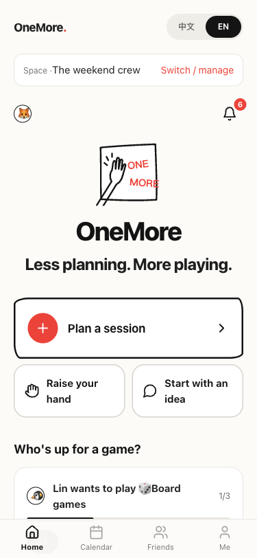
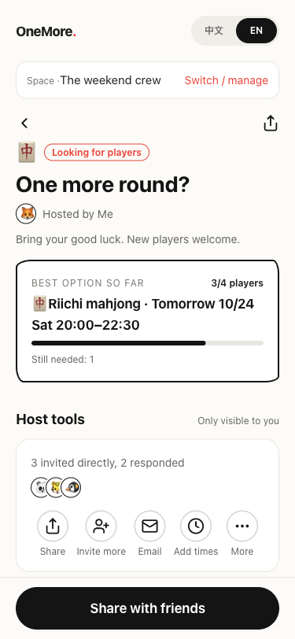
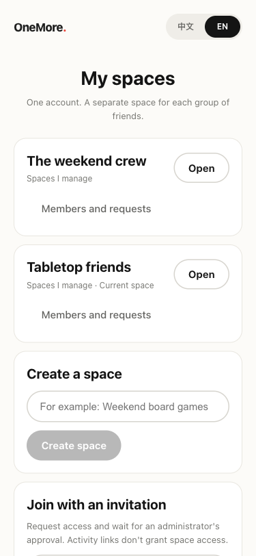

[English](README.md) · [简体中文](README.zh-CN.md)


# A plan your friends can actually make.

“Let's play sometime” is easy. Finding enough people, a shared time and someone
to run the game is the part that breaks. **OneMore** brings those decisions into
one invitation: propose a few options, let friends respond, and confirm when
the same time works for the right people.

Built by **[Chaoan Li](https://github.com/ChaoanLi)** with AI-assisted development.
A mobile-first, self-hosted application for real groups of friends, with English
and Simplified Chinese throughout the app.

[Get started](#run-it-locally) · [Architecture](docs/ARCHITECTURE.md) · [Deploy](docs/DEPLOY.md) · [中文介绍](README.zh-CN.md)

## From “sometime” to a shared time

1. **Propose.** Choose games, player counts, required roles and candidate times.
2. **Find overlap.** Friends select availability; OneMore checks the same slot,
   headcount, roles and waiting list together.
3. **Make it happen.** The host confirms. In-app notifications, a revocable
   calendar feed and optional email help everyone follow through.

### Your people, in their own spaces

One account can switch between independent spaces. Your regular game group and
another circle of friends keep separate members, events, invitations,
notifications and calendars—even when someone belongs to both. Space invitations
require administrator approval; an event link alone never grants membership.

### Across languages and time zones

Switch English / 简体中文 without changing your time zone or losing a form in
progress. Times are stored in UTC and shown in each person's IANA time zone,
including daylight-saving changes. Your friends' own words stay as written.

### An assistant that stops at a draft

Type a sentence instead of starting with an empty form. The default is an
explicitly labelled local demo parser. An optional DeepSeek adapter can produce
a validated draft; you review it before creating anything. The deterministic
rules engine decides whether a group is ready.

## A closer look

Screenshots below are from the running H5 app with synthetic demo data.

<table>
<tr><th>Make a plan</th><th>Find the overlap</th><th>Keep groups separate</th></tr>
<tr><td><a href="docs/assets/home-en.png"></a></td><td><a href="docs/assets/event-en.png"></a></td><td><a href="docs/assets/spaces-en.png"></a></td></tr>
</table>

## Engineering decisions worth looking at

| Decision | Why it matters |
| --- | --- |
| Explicit space-scoped data access | A guessed ID or shared link cannot cross group boundaries. |
| Membership generation checked at mail dispatch | Removing and re-adding someone does not revive old queued messages. |
| Shared time, quorum and state rules | Availability, required roles, capacity and host confirmation agree across screens. |
| Request-scoped localization | Concurrent users can use different languages; recipient emails use their own preference. |
| Separate request and content generations | Switching language discards stale responses while retaining unsaved drafts. |
| Validated AI draft boundary | A model cannot directly create events or invite friends. |

**Stack:** TypeScript · React 18 · Taro H5 · Hono · Node SQLite · Luxon · Zod · Vitest.
Read the [architecture](docs/ARCHITECTURE.md) or the [original domain design](docs/DESIGN.md).

## Run it locally

Use **Node 24** (minimum 22.13 for built-in SQLite) and npm.

```sh
npm ci
# Optional, isolated sample data. Keep the same DB_PATH for seed and app.
DB_PATH=/tmp/onemore-demo.db npm run seed
DB_PATH=/tmp/onemore-demo.db npm run dev
```

Open [localhost:10086](http://localhost:10086). API runs on `:8787`.
Without seeding, create a nickname account and your first space in the UI.
The seed command prints synthetic account recovery codes for trying multiple
members; keep them out of screenshots and commits. Use a new database path to
restart a demo, preserving existing data.

```sh
npm test               # Domain, API, isolation and client-context tests
npm run typecheck      # Core, server and client
npm run build          # Core + production H5
npm start              # Rebuild, then serve H5 and API on :8787
```

For a domain and automatic HTTPS, use [Docker + Caddy deployment](docs/DEPLOY.md).
Copy `.env.example` to `.env` only when configuring services. Keep credentials
on the server. `DEEPSEEK_API_KEY` enables the optional model provider; SMTP
variables enable real email. `PUBLIC_URL` sets links in messages and calendars.
The internal npm namespace remains `@couju/*`.

## Status and scope

The H5 application supports spaces, friends and private circles, game preferences,
events, waiting lists, role-aware quorum, recurring candidate slots, “I want to
play” interests, calendars and notifications. Automated checks and local browser
journeys are documented in [verification](docs/VERIFICATION.md).

- **Prepared for self-hosting; no public demo deployment yet.** Real reachability
  from mainland China and the US still needs testing after deployment.
- **DeepSeek and SMTP:** adapters exist; real credentials and delivery have not
  been verified. Unconfigured email uses a logged demo transport.
- **WeChat:** scripts remain, but mini-program builds, device behavior, WeChat
  login and subscription messages are unverified or unimplemented.
- **Single-instance scope:** SQLite and in-process jobs suit small groups.
  Long-lived guest sessions have no device management; no multi-instance setup.
- Historical free-text notifications keep their original language. User content
  is deliberately preserved rather than machine-translated.

## Source available for noncommercial use

Original work is licensed under **[PolyForm Noncommercial 1.0.0](LICENSE)**.
It permits noncommercial use, modification and redistribution within its terms;
commercial uses outside those permissions require separate authorization from
the maintainer. This is source-available software, **not OSI-approved open source**.
The license text controls, including its stated personal and organizational uses.
[Required notice](NOTICE) · [Third-party licenses](THIRD_PARTY_NOTICES.md).

Bug reports, translations and focused improvements are welcome. See
[contributing](CONTRIBUTING.md) and [security reporting](SECURITY.md).
