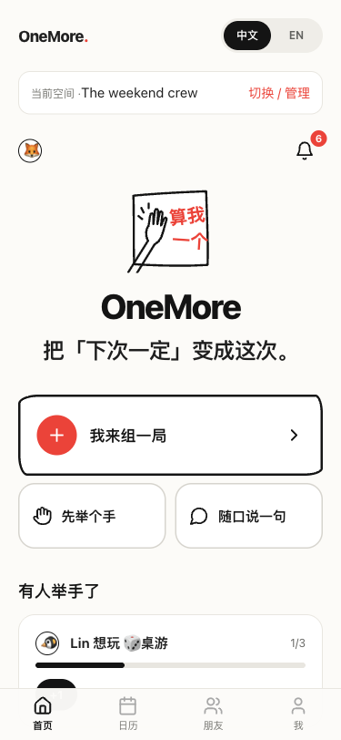
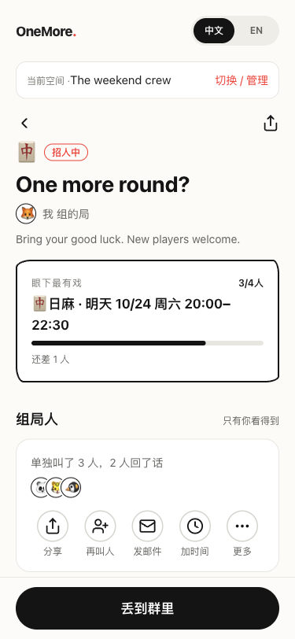
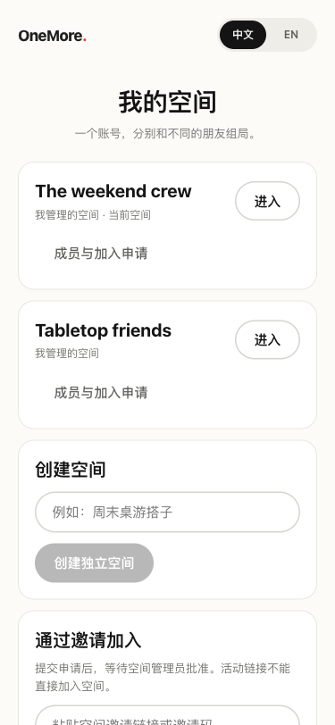

[English](README.md) · [简体中文](README.zh-CN.md)


# 把「下次一定」变成这次。

“改天一起玩”很容易。真正难的是凑够人、找到共同空闲，还得有人能当 GM。
**算我一个 · OneMore** 把这些决定放进同一个邀请：给出几个玩法和时间，
朋友勾选意愿，等同一时段的人数和角色都合适，再确认开局。

由 **[Chaoan Li](https://github.com/ChaoanLi)** 创建并维护，采用 AI 辅助开发。
面向真实朋友圈、手机优先、可自行部署的应用，界面支持简体中文和英文。

[本地运行](#本地运行) · [架构说明](docs/ARCHITECTURE.md) · [部署指南](docs/DEPLOY.md) · [English](README.md)

## 从“改天”到一个共同的时间

1. **先提议。** 选玩法、人数、所需角色和几个候选时段。
2. **找交集。** 朋友勾选空闲；系统同时判断共同时间、人数、角色和候补。
3. **真的开局。** 发起人确认，站内通知、可撤销的日历订阅和可选邮件帮助大家赴约。

### 同一个账号，各自的朋友圈

一个账号可以切换多个独立空间。固定游戏群和另一拨朋友的成员、活动、邀请、
通知与日历各自独立，同一个人可以同时参加两边。加入空间需要管理员批准；
拿到活动链接也不能绕过成员资格。

### 跨语言，也跨时区

随时切换 English / 简体中文，不改变时区，也不丢掉填写到一半的表单。
时间以 UTC 保存，按每个人的 IANA 时区显示，处理夏令时和跨日。
朋友写下的名字、活动标题和备注保持原样。

### 助手写草稿，你决定发不发

用一句话开始，而不必面对空白表单。默认是明确标注的本地演示解析器；
可选接入 DeepSeek，生成经过结构校验的草稿。创建前由你检查确认，
是否能成团则始终由确定性的规则引擎判断。

## 看看实际界面

以下为运行中的 H5 应用截图，使用隔离的虚构演示数据。

<table>
<tr><th>把约局提上日程</th><th>找到共同时间</th><th>朋友圈各自独立</th></tr>
<tr><td><a href="docs/assets/home-zh.png"></a></td><td><a href="docs/assets/event-zh.png"></a></td><td><a href="docs/assets/spaces-zh.png"></a></td></tr>
</table>

## 值得看的工程取舍

| 选择 | 解决的问题 |
| --- | --- |
| 显式按空间访问数据 | 猜到 ID 或拿到链接，也不能越过朋友圈边界。 |
| 发件时检查成员资格代次 | 移除后重新加入，不会复活旧的待发邮件。 |
| 共用时间、成团与状态规则 | 多人共同空闲、角色、人数上限和发起人确认保持一致。 |
| 每个请求独立决定语言 | 并发用户可使用不同语言，邮件按收件人偏好发送。 |
| 区分请求和内容的版本 | 切换语言丢弃旧响应，同时保留未提交草稿。 |
| AI 仅生成受校验的草稿 | 模型不能直接创建活动或邀请朋友。 |

**技术栈：** TypeScript · React 18 · Taro H5 · Hono · Node SQLite · Luxon · Zod · Vitest。
详见[架构说明](docs/ARCHITECTURE.md)和[原始领域设计](docs/DESIGN.md)。

## 本地运行

推荐 **Node 24**，最低 22.13（需要内置 SQLite），使用 npm。

```sh
npm ci
# 可选：独立演示数据。seed 和应用使用同一个 DB_PATH。
DB_PATH=/tmp/onemore-demo.db npm run seed
DB_PATH=/tmp/onemore-demo.db npm run dev
```

打开 [localhost:10086](http://localhost:10086)，API 位于 `:8787`。
不运行 seed 也可以在界面里用昵称创建账号、创建第一个空间。
seed 会打印虚构演示账号的恢复码，方便模拟多位成员，请勿截入图片或提交仓库。
想重新演示时换一个数据库路径，保留已有数据。

```sh
npm test               # 领域、API、空间隔离及客户端上下文测试
npm run typecheck      # core、server、client 类型检查
npm run build          # core + 生产 H5
npm start              # 重新构建，再于 :8787 同时提供页面与 API
```

绑定域名和自动 HTTPS，参阅 [Docker + Caddy 部署指南](docs/DEPLOY.md)。
配置外部服务时，将 `.env.example` 复制为 `.env`，凭证仅留在服务器。
`DEEPSEEK_API_KEY` 启用可选模型；SMTP 变量启用真实邮件；
`PUBLIC_URL` 决定邮件与日历中的站点链接。代码内部 npm 命名空间仍为 `@couju/*`。

## 当前状态与边界

H5 已实现独立空间、好友与私密圈子、游戏偏好、活动、候补、角色成团判断、
多周候选时段、“我想玩”、日历与通知。实际运行的自动化检查和本地浏览器流程
见[验证记录](docs/VERIFICATION.md)。

- **已准备自行部署，尚无公网演示站。** 部署后仍需分别实测中国大陆与美国的可达性。
- **DeepSeek 与 SMTP：** 适配器已实现，尚未用真实凭证验证请求与邮件投递。
  未配置 SMTP 时使用只打印日志的演示传输。
- **微信：** 保留脚本，但小程序构建、真机行为尚未验证；微信登录、订阅消息尚未实现。
- **单实例范围：** SQLite 与进程内任务适合小群体；访客会话长期有效，
  尚无设备管理，也没有多实例部署方案。
- 历史纯文本通知保留原语言；用户自己写的内容不做机器翻译。

## 允许非商业使用的源码项目

项目原创部分采用 **[PolyForm Noncommercial 1.0.0](LICENSE)**。
在条款允许范围内，可以非商业使用、修改和再分发；超出许可范围的商业使用
需要向维护者取得单独授权。这是**源码可见项目，不是 OSI 定义的开源软件**。
具体范围以许可证原文为准，包括其对个人用途和非商业组织的规定。
[必须保留的声明](NOTICE) · [第三方许可](THIRD_PARTY_NOTICES.md)。

欢迎反馈问题、补充翻译与提交小而明确的改进。参阅
[贡献说明](CONTRIBUTING.md)和[安全问题反馈](SECURITY.md)。
