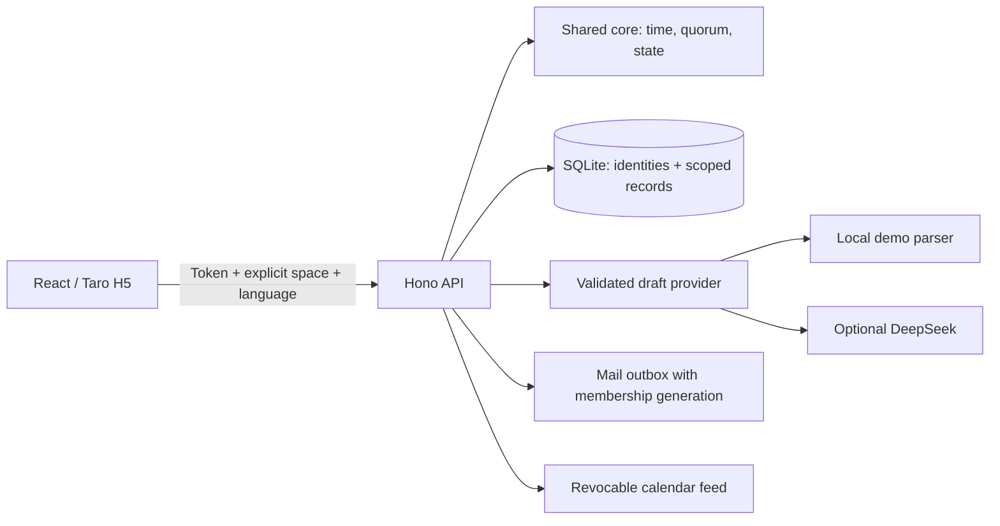

# Architecture and product decisions

OneMore turns a loose invitation into a concrete plan: propose games and time
slots, collect availability, evaluate headcount and roles, then let the host
confirm. The shared domain package owns the rules so the UI, API and optional
AI draft follow the same model.

## Separate spaces, shared identity

An account can belong to several spaces. Identity, verified email, time zone
and language preference belong to the account. Friend graphs, circles, custom
games, events, responses, interests, notifications, email switches and calendar
feeds belong to a space. Private circles and favorite friends also belong to
their creator; sharing a space does not expose these personal lists.

The root store handles identity and space membership. Business services receive
an immutable `store.forSpace(spaceId)`; business lookups always include the space.
The API authenticates the token and checks current membership for `X-Space-Id`,
including another check after asynchronous request-body reads. Resource IDs do
not grant access. An event link never substitutes for membership approval.

Membership has a generation identifier. Removing and re-adding the same account
creates a new generation: old mail cannot cross that boundary. Queued dispatch
also checks current membership, visibility, verified address and email settings.
Leaving cleans up future participation and credentials while retaining history.
Calendar feed tokens are scoped and revocable, although clients may retain data
already downloaded. See [migration policy](LEGACY-MIGRATION.md) for old databases.

## Time is data; language is presentation

Events store UTC instants; user preferences store IANA zones. The domain layer
resolves local scheduling and daylight-saving transitions with Luxon. Language
is `zh-CN` or `en`; changing language changes neither the zone nor the instant.

The client selects a saved account preference, then an explicit local preference,
then device language. HTTP requests carry `Accept-Language`. The server derives
a fresh display locale for each request. Email and calendar subscription text
use the account preference. No server-wide mutable locale is used.

Translation is explicit: source templates plus indexed arguments. User-written
titles, names and comments are never scanned or translated. New notifications
store message metadata and render for the current viewer. Old free-text
notifications remain historical text. On the client, locale changes invalidate
in-flight responses while preserving mounted form state and pending drafts;
account/space changes invalidate both response and content context.

## Deterministic rules, optional AI

Headcount alone is insufficient: enough people must share a time and any required
role, such as a GM. The core evaluates compatible responses, final confirmations,
capacity and waiting lists. A host confirms a proposed plan through a state
machine. The rule engine, not a language model, decides whether a group is ready.

The default provider is a local keyword-based demo parser. The optional DeepSeek
adapter produces a Zod-validated draft with an explicit timeout. Dates are resolved
in deterministic time-zone-aware code. A draft cannot create an event or send
invitations: the user reviews the form and submits it. Network or validation
failure leaves a manual form available. Real DeepSeek and SMTP are not yet
verified with production credentials.

## Deliberate limits

SQLite, an in-process scheduler and a memory rate limiter make one-instance
self-hosting simple. Horizontal scaling would require shared rate limiting,
coordinated jobs and a different persistence strategy. Long-lived guest tokens
have no device management. H5 is the verified target; WeChat build scripts do
not imply verified mini-program support. [Verification](VERIFICATION.md) records
what was actually run and what remains unverified.
